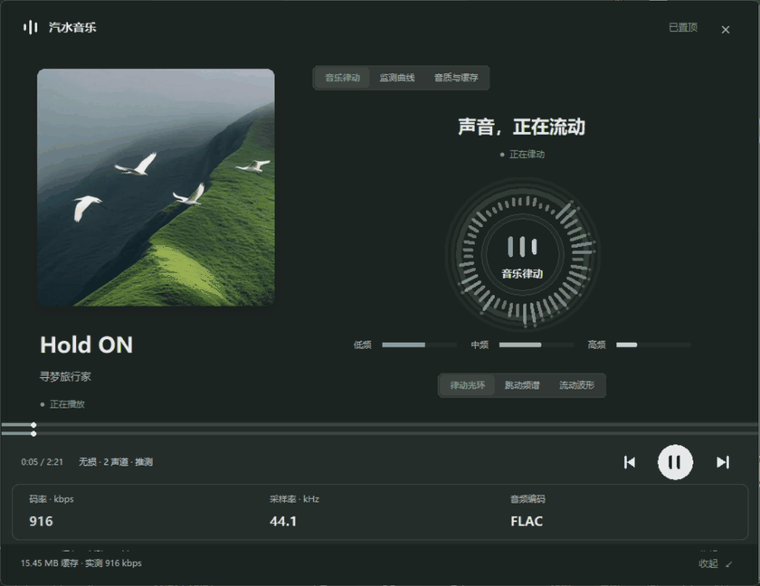

# 汽水音乐监测面板

一个常驻桌面的悬浮面板，实时显示电脑版**汽水音乐**当前播放歌曲的信息与**真实音质参数**。

参照汽水音乐的大封面布局，采用随当前封面变化的磨砂主题，支持悬浮小窗和展开仪表盘。
Windows 11 支持时使用系统 Desktop Acrylic 模糊背景；其他系统保留相同配色和清晰的圆角界面。
优先读取汽水音乐播放队列中的歌曲配色和 720×720 封面，缺少配色时从真实封面提取颜色。
换歌时封面、背景、按钮和律动颜色一起更新；主题颜色平滑过渡。
下图为实时音乐律动视图：


实际播放时录制的动态预览（依次切换光环、频谱和波形）：



---

## 一、使用方法

双击 **`启动汽水音乐监测面板.bat`** 即可。

| 操作 | 效果 |
|---|---|
| 按住歌名或顶部区域拖动 | 移动位置 |
| **双击歌名或顶部区域** / 点「展开 / 收起」 / `Ctrl+E` | 展开 / 收起仪表盘（默认展开） |
| 底部上一首、播放 / 暂停、下一首 | 控制汽水音乐；播放器不支持的操作会禁用 |
| 点击底部进度条 | 播放器支持定位时跳转到对应位置 |
| 「已置顶 / 置顶」按钮 | 置顶开关（默认开） |
| ✕ 图标 或 `Esc` | 退出 |
| 鼠标滚轮 | 详情区内容超出屏幕时滚动查看 |
| 点「打开目录」 | 打开汽水音乐的音频缓存文件夹 |
| 「音乐律动 / 监测曲线 / 音质与缓存」 | 切换实时图形、监测曲线和详细参数 |
| 「律动光环 / 跳动频谱 / 流动波形」 | 切换实时音乐可视化效果 |
| 「音频电平 / 读写速率 / 内存占用」 | 切换当前监测曲线 |
| 「30 秒 / 60 秒 / 120 秒」 | 切换曲线时间范围 |
| 鼠标停留在曲线上 | 查看对应时刻的采样值 |

关闭面板不会影响汽水音乐；面板退出时会自动结束后台采集进程。
面板默认只允许运行一个实例（重复双击不会开出第二个）；如需多块屏幕各开一个，
先设环境变量 `SODA_PANEL_ALLOW_MULTI=1` 再启动。

---

## 二、能监测到的信息

### 悬浮小窗（常驻）
- 歌曲名、歌手、播放状态；显示真实高清封面，获取不到高清图时使用系统封面
- **音频码率**（大号字，颜色随档位变化）
- 推断音质档位 · 编码格式 · 采样率 · 声道数
- 播放进度 / 总时长
- 跟随系统声音实时跳动的迷你频谱
- 缓存文件体积 · 实测码率 · 是否加密

### 仪表盘（双击展开）
- **音乐律动**：圆形频谱光环、跳动频谱柱、实时波形，可随时切换
- **鼓点响应**：光环大小和脉冲跟随低频能量变化，停播或失去采集后自然回落
- **磨砂玻璃**：系统背景模糊配合半透明内容层，文字和图形保持清晰
- **封面主题**：背景、按钮、频谱和波形使用当前歌曲的配色，换歌时平滑切换
- **实时趋势**：系统输出电平（%）、汽水音乐进程读写速率（KB/s）、内存占用（MB）
- **交互曲线**：30 / 60 / 120 秒历史，可悬停查看数值；纵轴自动调整
- **缓存音质分布**：各音质档位的数量和比例
- **音质参数**：编码格式、声明码率、实测码率、采样率、声道、位深、是否无损、加密方式、容器格式、推断档位
- **当前缓存文件**：文件名、体积、时长、缓存时间、完整路径
- **同一首歌的历史档位**：这首歌在缓存里存在过的所有音质版本对比
- **缓存库统计**：缓存总量、各档位分布
- **进程信息**：CPU / 内存 / IO 速率

曲线从面板启动时开始积累，只记录新的采样；采集不到数据或连接中断时留空。
音频电平来自 Windows 当前输出设备，可能包含其他应用的声音，是电平变化曲线。

音乐律动使用独立的 WASAPI 输出回环采集，约每 30 毫秒分析一次真实音频，
以 4096 点 FFT 提取 40 Hz–16 kHz 的 48 个对数频段，同时提取波形和低频鼓点能量。
图形约每秒刷新 30 次，并做快速上升、缓慢回落的平滑处理。
PCM 音频只在内存中处理，临时文件里仅保存图形数值，不生成录音文件。
更换默认输出设备后会自动重新连接；它捕获系统输出的混合声音，不采集麦克风。

---

## 三、数据来源与原理

面板把三个来源拼在一起：

| 来源 | 位置 | 提供 |
|---|---|---|
| Windows 媒体会话 (SMTC) | 系统 WinRT 接口 | 歌名、歌手、播放状态、总时长 |
| 汽水音乐播放队列 | `%APPDATA%\SodaMusic\LunaStorage\QueueCache` | 按歌名、歌手、时长匹配封面地址和主题色 |
| **音频缓存文件** | `%APPDATA%\SodaMusic\LunaCacheV2\*.bin` | 编码、码率、采样率、声道、位深、加密方式 |
| 缓存索引 / 采集器 | 同上 / PowerShell | 缓存路径、音频电平、进程资源 |

### 为什么码率是精确值，而不是估算

汽水音乐把播放过的歌曲缓存成 M4A 文件。**只有音频数据体是加密的**（cenc / AES-128），
文件头部的 `moov` 结构是**明文**的，其中：

- `stsd` 的 `frma` 盒子 → **原始编码格式**（`mp4a` = AAC，`fLaC` = FLAC 无损）
- `esds` 盒子 → **音频流自己声明的码率**（avg / max）、AAC 档次、采样率、声道
- `dfLa` 盒子（无损档）→ **位深**、无损采样率、总样本数
- `mvhd` 盒子 → 精确时长
- `schm` 盒子 → 加密方案

再结合文件体积 ÷ 时长，得到**实测码率**（含容器开销，比声明值略高约 1.5%）。
所以面板显示的是音频流的真实参数，不是网络流量估算。

### 如何锁定"当前这首歌"

汽水音乐的缓存文件名是无意义 UUID，而且**同一首歌往往存有多个音质档位**
（实测一首歌最多 6 个版本：流畅 64k / 标准 128k / 较高 256k / 极高 320k / 无损 FLAC）。
只靠"时长 + 缓存时间最新"会选错档位，所以面板按**由强到弱四路信号**判断，
并把依据直接显示出来：

| 依据（界面文案） | 判定方式 | 可信度 |
|---|---|---|
| **播放中锁定** | 以独占方式打开候选文件，返回共享冲突（`ERROR_SHARING_VIOLATION`）说明该文件正被播放器持有 | 最可靠，可精确到档位 |
| **唯一缓存** | 该时长在缓存里只有一个候选文件 | 可靠 |
| **按访问时间推测** | 播放器开始播放时会读取缓存文件，其访问时间被刷新；取明显最新的那个 | 中等 |
| **按缓存时间推测** | 取缓存时间最新的文件 | 只能算粗猜 |

- 小窗的档位行只有后两种会带 `· 推测` 后缀；
- 「音质与缓存」页会写明匹配依据，并列出缓存文件、**缓存时间**和**最后访问时间**；
- 如果当前是推测结果，播放期间每 5 秒自动重试，一旦拿到更强信号就升级为准确值。

> 实测例：某首歌缓存里有 6 个档位，其中 64k 版本缓存时间最新（17:14），
> 但真正在播的是 17:11 落盘的无损 FLAC（被播放器占用）。靠占用探测才能选对。
> 另一首歌 4 个候选全是 256k，靠访问时间（本次播放开始时被刷新）才选对。

### 档位推断规则

依据实测到的缓存样本反推：

| 声明码率 | 编码 | 推断档位 |
|---|---|---|
| — (FLAC) | FLAC | **无损**（真无损，可显示 16/24 bit） |
| ~320 kbps | AAC-LC | 极高 |
| 256 kbps | AAC-LC | 较高 |
| 128 kbps | AAC-LC | 标准 |
| 64 kbps | AAC-LC | 流畅 |

---

## 四、已知限制（如实说明）

1. **播放进度是推算的**。汽水音乐不刷新 SMTC 时间轴（实测连续 24 秒一直返回同一个值），
   所以面板在检测到时间轴停滞时改用墙钟推算；一旦时间轴恢复更新会自动同步回真实值。
2. **缓存音频数据体是加密的**，不能直接解码缓存。音乐律动从系统已经播放的声音中提取波形和频谱，
   不解密缓存，也不能用可视化验证解码后的实际音质。
3. **进程信息在受限环境下可能为空**。如果面板运行在沙箱/受限账户中，会看不到汽水音乐进程，
   此时 CPU/内存显示"不可用"，其余功能不受影响。
4. **专辑名字段为空**，汽水音乐没有通过系统接口提供。
5. **首次启动会扫描缓存目录**（约 400 个文件，需数十秒），之后走索引缓存，秒开。
   统计结果每 60 秒刷新一次；索引建立期间面板会先显示"正在建立缓存索引…"。

---

## 五、文件说明

| 文件 | 作用 |
|---|---|
| `启动汽水音乐监测面板.bat` | 启动器（自动寻找 Python，双击即用） |
| `panel.py` | 程序入口、采集进程管理、播放进度推算 |
| `dashboard.py` | 仪表盘布局、交互和数据刷新 |
| `ui_widgets.py` | 圆角卡片、交互曲线、历史采样、音质分布绘制 |
| `music_visualizer.py` | 音乐光环、实时频谱、波形和平滑动画 |
| `reactive_audio.py` | 快速音频采集的进程管理、帧校验和断线处理 |
| `audio_reactive.ps1` / `audio_reactive.cs` | WASAPI 输出回环、PCM 解析、FFT 和低频脉冲检测 |
| `glass_theme.py` | Windows 原生磨砂背景及内容透明度 |
| `artwork.py` / `album_theme.py` | 高清封面、歌曲匹配、异步加载和封面主题色 |
| `tests/test_artwork.py` | 同名歌曲、封面地址、配色和文字可读性检查 |
| `tests/test_trends.py` | 采样、断线和时间范围检查 |
| `tests/test_reactive.py` / `tests/test_spectrum.ps1` | 律动帧、平滑、静音、频段和 PCM 解析检查 |
| `analyze_cache.py` | 音频缓存解析模块（编码/码率/位深/匹配） |
| `smtc_helper.ps1` | 系统信息采集器（歌曲信息/音频电平/进程） |
| `cache_index.json` | 缓存解析索引（首次运行自动生成，可随时删除） |
| `screenshot.png` | 界面截图 |
| `rhythm-preview.gif` | 实际音乐播放时录制的三种律动效果预览 |

### 命令行用法

```powershell
# 无界面自检：打印当前歌曲与解析出的音质参数
python panel.py --selftest

# 启动后直接展开仪表盘
python panel.py --expanded

# 启动悬浮小窗
python panel.py --compact

# 验证曲线采样与数据边界
python -m unittest discover -s tests -v

# 验证真实 FFT 对低、中、高频及音量变化的响应
powershell -NoProfile -ExecutionPolicy Bypass -File tests\test_spectrum.ps1

# 直接解析缓存目录，统计各档位分布
python analyze_cache.py

# 指定时长，查看匹配到的缓存及其音质
python analyze_cache.py 199.1
```

---

## 六、依赖

- Windows 10 / 11
- Python 3.9+（需含 tkinter，官方安装包默认包含）
- Pillow：封面缩放、圆角、柔和阴影和取色；本机启动器优先使用已包含 Pillow 的运行环境
- 高清封面首次加载需要联网；已经加载过的封面会缓存，下次可直接显示

实现依据：[Windows 输出回环](https://learn.microsoft.com/windows/win32/coreaudio/loopback-recording)、
[Desktop Acrylic](https://learn.microsoft.com/windows/win32/api/dwmapi/ne-dwmapi-dwm_systembackdrop_type)、
[Apple 材质设计](https://developer.apple.com/design/human-interface-guidelines/materials)。
