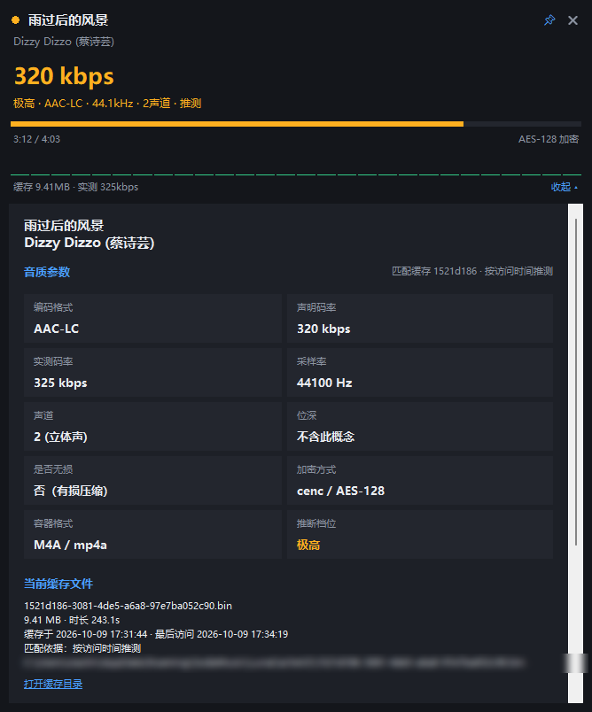

# 汽水音乐监测面板

一个常驻桌面的悬浮面板，实时显示电脑版**汽水音乐**当前播放歌曲的信息与**真实音质参数**。

下图是播放无损曲目时展开的完整面板（顶部是小窗形态，下方是详情）：



---

## 一、使用方法

双击 **`启动汽水音乐监测面板.bat`** 即可。

| 操作 | 效果 |
|---|---|
| 按住面板拖动 | 移动位置 |
| **双击面板** | 展开 / 收起完整面板 |
| 📌 图标 | 置顶开关（默认开） |
| ✕ 图标 或 `Esc` | 退出 |
| 鼠标滚轮 | 详情区内容超出屏幕时滚动查看 |
| 点「打开缓存目录」 | 打开汽水音乐的音频缓存文件夹 |

关闭面板不会影响汽水音乐；面板退出时会自动结束后台采集进程。

---

## 二、能监测到的信息

### 悬浮小窗（常驻）
- 歌曲名、歌手
- **实时码率**（大号字，颜色随档位变化）
- 推断音质档位 · 编码格式 · 采样率 · 声道数
- 播放进度 / 总时长
- 实时音频电平跳动条
- 缓存文件体积 · 实测码率 · 是否加密

### 完整面板（双击展开）
- **音质参数**：编码格式、声明码率、实测码率、采样率、声道、位深、是否无损、加密方式、容器格式、推断档位
- **当前缓存文件**：文件名、体积、时长、缓存时间、完整路径
- **同一首歌的历史档位**：这首歌在缓存里存在过的所有音质版本对比
- **缓存库统计**：缓存总量、各档位分布
- **进程信息**：CPU / 内存 / IO 速率

---

## 三、数据来源与原理

面板把三个来源拼在一起：

| 来源 | 位置 | 提供 |
|---|---|---|
| Windows 媒体会话 (SMTC) | 系统 WinRT 接口 | 歌名、歌手、播放状态、总时长 |
| **音频缓存文件** | `%APPDATA%\SodaMusic\LunaCacheV2\*.bin` | 编码、码率、采样率、声道、位深、加密方式 |
| 缓存索引 / 采集器 | 同上 / PowerShell | 缓存路径、音频电平、进程资源 |

### 为什么码率是精确值，而不是估算

汽水音乐把播放过的歌曲缓存成 M4A 文件。**只有音频数据体是加密的**（cenc / AES-128），
文件头部的 `moov` 结构是**明文**的，其中：

- `stsd` 的 `frma` 盒子 → **原始编码格式**（`mp4a` = AAC，`fLaC` = FLAC 无损）
- `esds` 盒子 → **音频流自己声明的码率**（avg / max）、AAC 档次、采样率、声道
- `dfLa` 盒子（无损档）→ **位深**、无损采样率、总样本数
- `mvhd` 盒子 → 精确时长
- `schm` 盒子 → 加密方案

再结合文件体积 ÷ 时长，得到**实测码率**（含容器开销，比声明值略高约 1.5%）。
所以面板显示的是音频流的真实参数，不是网络流量估算。

### 如何锁定"当前这首歌"

汽水音乐的缓存文件名是无意义 UUID，而且**同一首歌往往存有多个音质档位**
（实测一首歌最多 6 个版本：流畅 64k / 标准 128k / 较高 256k / 极高 320k / 无损 FLAC）。
只靠"时长 + 缓存时间最新"会选错档位，所以面板按**由强到弱四路信号**判断，
并把依据直接显示出来：

| 依据（界面文案） | 判定方式 | 可信度 |
|---|---|---|
| **播放中锁定** | 以独占方式打开候选文件，返回共享冲突（`ERROR_SHARING_VIOLATION`）说明该文件正被播放器持有 | 最可靠，可精确到档位 |
| **唯一缓存** | 该时长在缓存里只有一个候选文件 | 可靠 |
| **按访问时间推测** | 播放器开始播放时会读取缓存文件，其访问时间被刷新；取明显最新的那个 | 中等 |
| **按缓存时间推测** | 取缓存时间最新的文件 | 只能算粗猜 |

- 小窗的档位行只有后两种会带 `· 推测` 后缀；
- 展开面板会写明「匹配缓存 xxxxxxxx · 依据」，并列出该文件的**缓存时间**和**最后访问时间**；
- 如果当前是推测结果，播放期间每 5 秒自动重试，一旦拿到更强信号就升级为准确值。

> 实测例：某首歌缓存里有 6 个档位，其中 64k 版本缓存时间最新（17:14），
> 但真正在播的是 17:11 落盘的无损 FLAC（被播放器占用）。靠占用探测才能选对。
> 另一首歌 4 个候选全是 256k，靠访问时间（本次播放开始时被刷新）才选对。

### 档位推断规则

依据实测到的缓存样本反推：

| 声明码率 | 编码 | 推断档位 |
|---|---|---|
| — (FLAC) | FLAC | **无损**（真无损，可显示 16/24 bit） |
| ~320 kbps | AAC-LC | 极高 |
| 256 kbps | AAC-LC | 较高 |
| 128 kbps | AAC-LC | 标准 |
| 64 kbps | AAC-LC | 流畅 |

---

## 四、已知限制（如实说明）

1. **播放进度是推算的**。汽水音乐不刷新 SMTC 时间轴（实测连续 24 秒一直返回同一个值），
   所以面板在检测到时间轴停滞时改用墙钟推算；一旦时间轴恢复更新会自动同步回真实值。
2. **封面用"歌曲首字"占位图**。SMTC 接口本身提供封面缩略图，但 Windows PowerShell 5.1 的
   WinRT 互操作无法把缩略图流传给 .NET（接口转换失败），改用 C# 编译又依赖 Windows SDK 契约文件，
   换台机器就会失效。为了不引入这种脆弱依赖，改用占位图。
3. **音频数据体是加密的**，因此无法解码出波形/频谱，也无法验证解码后的实际音质。
4. **进程信息在受限环境下可能为空**。如果面板运行在沙箱/受限账户中，会看不到汽水音乐进程，
   此时 CPU/内存显示"不可用"，其余功能不受影响。
5. **专辑名字段为空**，汽水音乐没有通过系统接口提供。
6. **首次启动会扫描缓存目录**（约 400 个文件，需数十秒），之后走索引缓存，秒开。
   统计结果每 60 秒刷新一次。

---

## 五、文件说明

| 文件 | 作用 |
|---|---|
| `启动汽水音乐监测面板.bat` | 启动器（自动寻找 Python） |
| `soda_monitor/panel.py` | 面板主程序（tkinter 界面 + 主循环） |
| `soda_monitor/analyze_cache.py` | 音频缓存解析模块（编码/码率/位深等） |
| `soda_monitor/smtc_helper.ps1` | 系统信息采集器（歌曲信息/音频电平/进程） |
| `soda_monitor/cache_index.json` | 缓存解析索引（自动生成，可随时删除） |

### 命令行用法

```powershell
# 无界面自检：打印当前歌曲与解析出的音质参数
python panel.py --selftest

# 直接解析缓存目录，统计各档位分布
python analyze_cache.py

# 指定时长，查看匹配到的缓存及其音质
python analyze_cache.py 199.1
```

---

## 六、依赖

- Windows 10 / 11
- Python 3.8+（需含 tkinter，官方安装包默认包含）
- 无需安装任何第三方库（不需要 pip install）
